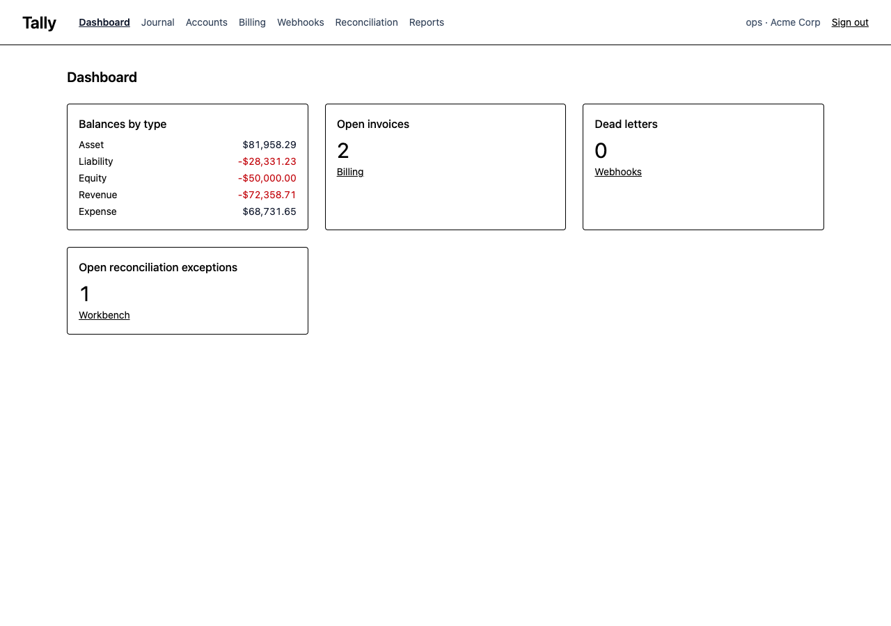
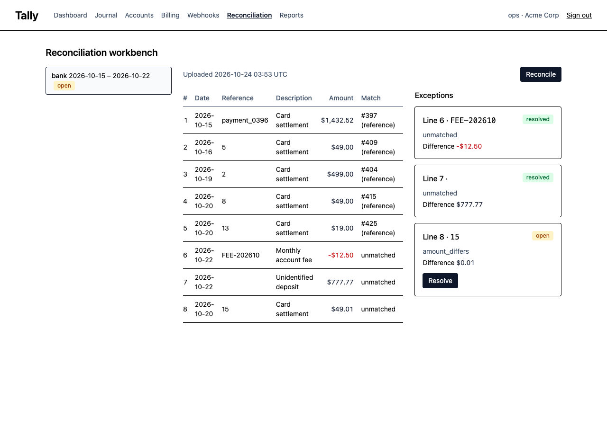
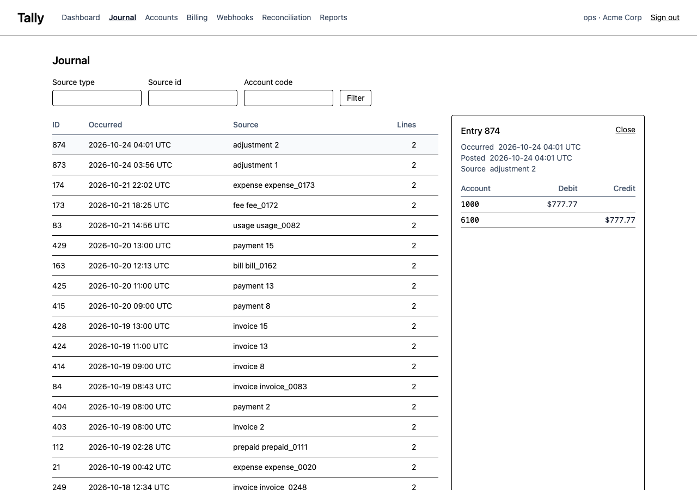
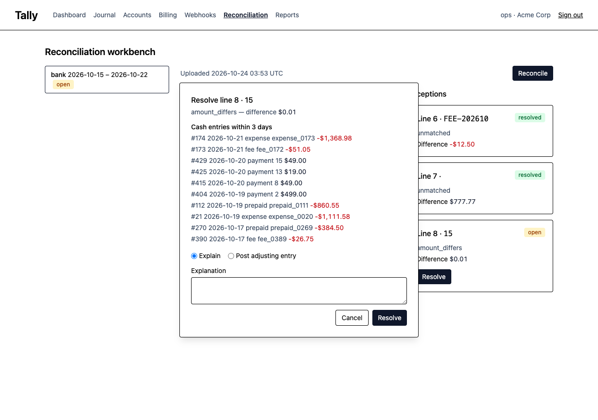

# Tally

Billing and ledger platform in Python: a double-entry ledger with a provable balancing invariant, idempotent posting under concurrency, subscription billing against Stripe test mode, webhooks in both directions, statement reconciliation, a nightly partner report orchestrated by Airflow, and a Vue 3 operations console.

A tenant posts financial events through an API. Tally posts each one as a balanced journal entry or rejects it with the reason. Subscriptions invoice on a schedule and collect through Stripe, and the ledger stays the source of truth. You import bank statements, Tally reconciles them against the journal, and an operator resolves the lines that do not match from the console. Each write is idempotent, posting locks accounts in a fixed order, and nobody edits the journal after the fact: a correction is a reversing entry. Docker Compose runs the whole thing with no cloud account and no card on file.

**Status.** Phases 0 to 6 are done: everything below runs from a clean checkout with Docker and uv. Phase 7 (stretch items) is open. The phase list at the end records what landed and when.

## Three-minute demo

Three minutes, one command, no accounts:

```bash
scripts/demo.sh
```

It brings compose up (Postgres, Redis, stripe-mock, RustFS, Jaeger, Airflow), migrates and seeds two tenants with 90 days of entries, starts Django, a Celery worker and Beat, then walks the system:

1. posts a balanced entry and replays the same `Idempotency-Key` (second response carries `Idempotent-Replayed: true`);
2. pays an invoice: a `PaymentIntent` on stripe-mock, then the signed `payment_intent.succeeded` webhook back to the API, which posts cash against receivables;
3. settles yesterday and triggers the `partner_daily_report` DAG in Airflow, which writes a CSV per tenant to the S3 bucket;
4. prints the balances of cash, receivables and revenue, and the links: Jaeger traces, Airflow, `/internal/metrics`.

Then `make console` and open <http://localhost:8001> as `ops` / `ops-demo` for the dashboard, journal, reconciliation workbench and the rest. Each request the demo made is a trace in Jaeger at <http://localhost:16687>, including the outbox write and the Celery delivery that followed it.

## Architecture

```
Tenant systems ──► POST /entries, /subscriptions, /statements   (X-Api-Key, Idempotency-Key)
                    │  rate limiter (Redis token bucket)         problem+json on every error
                    ▼
            Django + DRF  (tally/api)
                    │
            application use cases ── ports ──► adapters (Django ORM, Stripe gateway, webhook sender)
                    │
            domain (pure Python: Money, Account, JournalEntry, posting and matching rules)
                    │
            Postgres 17: journal_entries, journal_lines (append-only, balancing trigger),
                         account_balances (projection), idempotency_records, outbox,
                         subscriptions, invoices, statements, reconciliation_exceptions
                    ▲
   Celery workers ──┤  bill_due_subscriptions (Beat), deliver_webhooks (outbox), expire_idempotency,
                    │  process_stripe_event ──► Temporal 7233: DunningWorkflow per unpaid invoice
   Stripe test mode ──► POST /webhooks/stripe (signature verified, deduplicated)
   Airflow ─────────── partner_daily_report ──► S3 bucket reports/ (RustFS) ──► report.ready webhook

Console (Vue 3, Vite, Tailwind, Pinia, Storybook, Cypress) ──► session-authenticated JSON endpoints,
                                                               served by Django + whitenoise
OpenTelemetry ──► Jaeger 16687 (one trace: request, outbox write, Celery delivery, tenant endpoint)
/internal/metrics ► request latency, posting rate, projection lag, deliveries by state, queue depth
```

| Directory | Role | Port |
|---|---|---|
| `tally/domain` | Pure Python: money, accounts, journal entries, posting invariant, matching rules. Imports nothing from Django | – |
| `tally/application` | Use cases (`PostEntry`, `ReverseEntry`, `BillSubscription`, `ReconcileStatement`) over repository ports | – |
| `tally/adapters` | Django models and repositories, Stripe gateway, webhook sender, Redis rate limiter | – |
| `tally/api` | Django REST Framework views, serializers, OpenAPI | 8001 |
| `console/` | Vue 3 operations console | 5173 |
| `airflow/` | `partner_daily_report` DAG | 8081 |
| `docs/runbooks` | Dead-letter growth, projection lag, Stripe webhook failures, Beat not firing | – |
| `scripts/` | `demo.sh`, `stripe-listen.sh` | – |

## Stack

Python 3.13 · Django 6.0 · Django REST Framework 3.18 · Celery 5.6 + Redis 7 · Temporal (Python SDK) · PostgreSQL 17 · Stripe (test mode) · Airflow · RustFS (S3 API) · Hypothesis · pytest · import-linter · Vue 3.5 · Vite 8 · TypeScript 6 · Tailwind CSS 4 · Pinia 4 · Storybook · Cypress · Lighthouse CI · OpenTelemetry + Jaeger · django-prometheus · structlog · GitHub Actions

Prerequisites: Docker with Compose v2, uv 0.12+, Node 26, Stripe CLI, a Stripe account in test mode (free, no card). Copy `.env.example` to `.env`; the defaults work against compose without a Stripe key.

```bash
docker compose up -d --wait   # Postgres, Redis, stripe-mock, RustFS with the reports bucket, Jaeger, Temporal
make dev                      # migrate, Django on 8001, Celery worker and Beat
make test                     # pytest against the compose Postgres
uv run python manage.py seed_demo       # two tenants, 90 days of entries
uv run python manage.py replay_balances # rebuild the balance projection
make lint                     # ruff, mypy, import-linter
make console                  # build the console; `make dev` serves it on 8001
make openapi                  # regenerate console/openapi.json and the TypeScript client types
scripts/demo.sh               # the whole system end to end, about three minutes
cd console && npm ci && npm run dev   # Vite on 5173 for console work, proxies /api and /console to 8001
```

## The ledger

Double entry records each event twice: once where value came from and once where it went. An invoice for 149.00 debits accounts receivable (an asset grows) and credits revenue (income recognized). The payment that settles it debits cash and credits receivable. Each side is a `Line` with a signed amount; debits are positive, credits negative, and the lines of one `JournalEntry` always sum to zero. Because every entry is zero-sum, the sum of all balances across the chart is zero at every instant, and any balance can be recomputed from the journal alone.

An `Account` has a type (asset, liability, equity, revenue, expense), a code, a currency and a tenant. A `JournalEntry` has at least two `Line`s; within one entry the amounts sum to zero per currency, no line is zero, and every line is in its account's currency. That is the invariant, and it is enforced three times:

| Where | How | Why it is there |
|---|---|---|
| Domain | `post(entry, accounts)` in `tally/domain/journal.py` checks line count, zero lines, account ownership and currency, then balance, in that order, and raises `SingleLineEntry`, `ZeroLine`, `AmountOutOfRange`, `UnknownAccount`, `CurrencyMismatch` or `UnbalancedEntry` carrying the currency and the difference | The rule is one pure function. Hypothesis generates balanced entries and balanced entries nudged by a known delta; the property is that each balanced entry posts and each nudged one is rejected with that delta. CI runs 1,000 examples |
| Database | A `CHECK (amount <> 0)` on `journal_lines`, and a deferred constraint trigger on both `journal_entries` and `journal_lines` that, at commit, rejects any entry with fewer than two lines or a nonzero sum per currency | Protects the journal from code that bypasses the domain. The tests write raw SQL and prove an unbalanced insert fails at `COMMIT`, after the rows were visible inside the transaction |
| API | 422 problem details naming the currency and the difference | The caller learns what to fix |

**Append-only.** `journal_entries` and `journal_lines` carry `BEFORE UPDATE OR DELETE` triggers that raise, so neither the ORM nor a `psql` session can edit history. You correct a mistake with a reversing entry: `ReverseEntry` negates each line of the original and links the new entry to it; the link is a unique column, so the database refuses a second reversal and the repository reports it as `AlreadyReversed`. An auditor reads the original, the reversal and the correction.

**Projection.** Accounts do not store balances. `account_balances(account_id, balance, as_of)` is a projection: each post upserts the touched accounts inside the same transaction, and `manage.py replay_balances` truncates the table and rebuilds it with one `GROUP BY` over the journal. A test posts random entries, reverses some, corrupts the projection, and asserts the rebuild equals both the incremental table and a fresh fold in Python.

**What "event sourced" means here.** The journal is the event log; the balance is derived state you can throw away and recompute. That is event sourcing in its plain form, and it applies to the ledger only. Tenants, accounts, plans and subscriptions are ordinary rows updated in place.

**Money.** `Money(amount: Decimal, currency)` quantizes to six decimal places with `ROUND_HALF_EVEN` on construction, the one place rounding happens; display rounds to the currency's exponent (2 for USD, EUR, GBP; 0 for JPY). It refuses floats with `TypeError` and non-finite values with `ValueError`. Lines must fit `numeric(18,6)`, so `post()` rejects any line at or beyond 10^12 with `AmountOutOfRange` rather than letting the database truncate it. Mixed-currency arithmetic raises `CurrencyMismatch`.

**Multi-currency.** Each account has one currency and each line is in its account's currency; a plain entry balances per currency. An entry that touches two currencies declares a `conversion`: the base currency and, per other currency, how many units of base one unit is worth. The posting rule converts each currency's total at its rate, rounds half up to six places, and requires the converted totals to sum to zero; the caller books the rounding or revaluation difference as its own line (an FX gains and losses account). `POST /api/rates` keeps a per-tenant `exchange_rates` table (`currency`, `base`, `rate`, `as_of`), and an entry that names only its base gets the latest stored rate at or before its day; a currency without a rate is a 422 `MissingRate`. The database trigger applies the same rule with `round()`, so a raw insert cannot slip an unconverted entry past commit, and a reversal carries the original conversion so it balances the same way.

**Layers.** `tally/domain` imports nothing from Django; `import-linter` fails CI if it does. `tally/application` holds `PostEntry` and `ReverseEntry` over a `JournalRepository` Protocol and is tested against an in-memory fake. `tally/adapters` implements the port with the Django ORM, owns the migrations and triggers, and ships `seed_demo`: two tenants, a 12-account chart each, and 400 deterministic entries over 90 days.

## Posting API

Each request carries `X-Api-Key`; each write also carries `Idempotency-Key`. Tally issues keys per tenant and shows them once:

```bash
uv run python manage.py seed_demo                      # two tenants, chart of accounts, 90 days of entries
uv run python manage.py issue_api_key --tenant "Acme Corp" --name laptop   # prints tk_...
```

```http
POST /api/entries
X-Api-Key: tk_...
Idempotency-Key: 7f3c1a2e-...
Content-Type: application/json

{"occurred_at": "2026-11-03T14:02:00Z", "source": {"type": "invoice", "id": "inv_1042"},
 "lines": [{"account": "1200", "amount": "149.00", "currency": "USD"},
           {"account": "4000", "amount": "-149.00", "currency": "USD"}]}
```

```bash
KEY=$(uv run python manage.py issue_api_key --tenant "Acme Corp")
curl -s localhost:8001/api/entries -H "X-Api-Key: $KEY" -H "Idempotency-Key: $(uuidgen)" \
  -H 'Content-Type: application/json' \
  -d '{"occurred_at":"2026-11-03T14:02:00Z","source":{"type":"invoice","id":"inv_1042"},
       "lines":[{"account":"1200","amount":"149.00","currency":"USD"},
                {"account":"4000","amount":"-149.00","currency":"USD"}]}' | jq
curl -s localhost:8001/api/accounts/1200/balance -H "X-Api-Key: $KEY" | jq
```

| Endpoint | Behaviour |
|---|---|
| `POST /api/entries` | Validates shape (400), resolves account codes for the tenant, runs the domain posting rule (422 with the typed reason), posts in one transaction, returns 201 with the stored entry |
| `GET /api/entries` | Cursor-paginated, newest first; filters `source_type`, `source_id`, `account` |
| `GET /api/entries/{id}` | The entry with its lines, `reverses` and `reversed_by` links |
| `POST /api/entries/{id}/reverse` | Posts the negated entry linked to the original; a second reversal is 409 |
| `GET /api/accounts` | The tenant's chart of accounts |
| `GET /api/accounts/{code}/balance?as_of=` | Projection balance, or an exact fold over the journal up to `as_of` |
| `GET`, `POST /api/rates` | The tenant's exchange rates (`currency`, `base`, `rate`, `as_of`); the posting rule's default conversion source |
| `GET /api/me` | Confirms a key and names the tenant |
| `GET /openapi.json`, `GET /docs` | OpenAPI 3 document and Redoc, no key required |

Amounts travel as strings with six decimal places; the serializer rejects JSON numbers, so no float reaches the ledger.

| Concern | Behaviour |
|---|---|
| Idempotency | Every write needs an `Idempotency-Key` (400 without one). The key, a SHA-256 of method, path and body, and the response are stored in `idempotency_records` in the same transaction as the business write. Same key and same body: the stored response is replayed with `Idempotent-Replayed: true`. Same key and a different body: 422. A failed attempt rolls back with its record, so a corrected retry is accepted. Concurrent requests with one key block on the unique index and replay. Keys expire after 24 hours (Celery Beat, hourly) |
| Locking | Posting locks the touched accounts with `SELECT ... FOR UPDATE` ordered by account id, so two entries naming the same accounts in opposite order cannot deadlock. 20 threads post 200 entries at two accounts in alternating order and the final balances are exact |
| Consistency | Entries are read-your-writes; replays are byte-identical; the posting transaction updates the balance projection, and `/internal/metrics` reports its lag. [`docs/consistency.md`](docs/consistency.md) spells out which reads see what |
| Rate limiting | Token bucket per API key in Redis, one atomic Lua script, default 100 requests per minute with a per-tenant override. Every authenticated response carries `RateLimit-Limit`, `RateLimit-Remaining` and `RateLimit-Reset`; exhaustion is a 429 problem with `Retry-After` |
| Tenancy | Keys resolve to a tenant; each query filters by it. Another tenant's entry or account is a 404, not a 403. Beneath the repositories, Postgres row-level security is a second wall: authentication binds the connection to the tenant (`SET ROLE tally_app` plus a session setting) and policies on every tenant table hide and refuse other tenants' rows until the middleware unbinds at the end of the request; unbound connections (Celery, management commands, `/internal`) see every tenant |
| Authentication | `X-Api-Key` checked against an Argon2 hash; only an 8-character prefix is stored in the clear for lookup. Missing, unknown or revoked keys are 401 with `WWW-Authenticate: X-Api-Key` |
| Errors | RFC 9457 problem details everywhere (`application/problem+json`), one handler. Domain rejections are `type: .../posting/UnbalancedEntry` and friends; an unbalanced entry names the currency and the difference |

## Billing and Stripe

Tally owns the subscription engine and the books; Stripe collects. This repo does not use Stripe Billing; the engine is the point.

```
                 payment_succeeded
        ┌──────────────────────────────┐
        ▼                              │
   ┌─────────┐  payment_failed   ┌──────────┐
   │ active  │ ────────────────► │ past_due │
   └─────────┘                   └──────────┘
        │ cancel                      │ cancel
        ▼                              ▼
   ┌──────────────────────────────────────┐
   │              canceled                 │   (terminal)
   └──────────────────────────────────────┘
```

The state machine is a transition table in `tally/domain/billing.py`; a Hypothesis test walks every `(status, event)` pair and checks it is either in the table or rejected. Subscriptions bill in advance: `billed_through` null or past means due. Celery Beat runs `bill_due_subscriptions` every minute; each due subscription gets an `Invoice` (unique on subscription and period start, so an overlapping run cannot double-bill) and a journal entry debiting accounts receivable 1200 and crediting revenue 4000. Periods clamp to month end, so the 31st bills on the 28th and never skips a month.

**What Stripe does, what the ledger does.** `collect_invoice` creates one Stripe `Customer` per Tally customer and one `PaymentIntent` per invoice, then confirms it server-side with the `4242` test card, off session, redirects disabled, each call under its own idempotency key so a retried task cannot charge twice. `collect_invoice` stores the intent id on the invoice *before* confirming, so the webhook is the only writer of "paid": it resolves the invoice by that id, not by metadata, and a declined card reaches the same invoice as `payment_intent.payment_failed`. A paid invoice posts cash 1000 against receivable 1200 and reactivates a past-due subscription; a failed payment moves the subscription to `past_due`. Invoices do not store their journal entries; the journal's `(source_type, source_id)` links back to the invoice. One module, `tally/adapters/stripe_gateway.py`, builds the `StripeClient` from settings and is the only place that imports the SDK.

**Dunning.** A failed payment moves the subscription to `past_due` and starts one Temporal workflow per unpaid invoice (`tally/adapters/dunning_workflow.py`, task queue `tally-dunning`). The workflow sleeps three days, checks whether the webhook has marked the invoice paid, retries collection, sleeps four more days and checks again, and at day fourteen cancels the subscription through the same state machine. Temporal holds the timers and retries, so a worker restart loses nothing and the Temporal UI (<http://localhost:8233>) shows where each invoice stands. The workflow module imports only the SDK; the activities (`invoice_is_paid`, `retry_collection`, `cancel_subscription`) hold the Django code and run on a thread pool in `manage.py dunning_worker`, which `scripts/serve.sh` starts with the rest. Tests run the workflow against Temporal's time-skipping test server with fake activities, so the fourteen-day schedule proves itself in under a second; `TEMPORAL_ADDRESS` empty means payment failures start no workflow.

**Inbound webhooks.** `POST /webhooks/stripe` verifies `Stripe-Signature` with the SDK (HMAC-SHA256, timestamps older than five minutes rejected), inserts `event.id` into `stripe_events`, returns 200 and hands the row to `process_stripe_event`. A tampered signature gets a 400 and Tally stores nothing; the same event delivered twice gets a 200 and runs once; an intent Tally did not create (a `stripe trigger` fixture, say) gets a 200 and books nothing.

**Outbound webhooks.** Tenants register endpoints with `POST /api/webhook-endpoints` and receive the secret once. The business write puts its events (`entry.posted` for each journal entry, `invoice.issued`, `invoice.paid`, `subscription.past_due`, `subscription.active`, `reconciliation.exception`, `report.ready`) into `webhook_outbox` in its own transaction, so they commit or roll back with it. `deliver_due_webhooks` sweeps every ten seconds and posts the envelope `{"id", "type", "created_at", "data"}` with:

```
X-Tally-Signature: t=<unix seconds>,v1=<hex HMAC-SHA256(secret, "<t>.<raw body>")>
X-Tally-Event: invoice.paid
X-Tally-Delivery: <message id>
```

To verify: split the header, recompute the digest over `t` + `.` + the raw body with your secret, compare with `hmac.compare_digest`, and reject if `t` is more than 300 seconds from now. The recipe is Stripe's, so any Stripe webhook verifier accepts it; the test suite checks deliveries with `stripe.WebhookSignature.verify_header`. Retries follow 1 minute, 5 minutes, 30 minutes, 2 hours; the fifth failure parks the message in the dead-letter list at `GET /api/webhook-endpoints/{id}/dead-letters` with the last status and error, and `POST .../dead-letters/{id}/redeliver` puts it back in the queue.

**Local loop.** `stripe login` once, then `scripts/stripe-listen.sh` forwards sandbox events to `localhost:8001/webhooks/stripe` and prints the `whsec_` for `STRIPE_WEBHOOK_SECRET`. CI never calls Stripe: tests run against `stripe-mock` and hand-built events in the recorded shape. Tests marked `live` pay a real test-mode invoice with the `4242` card and are skipped without `STRIPE_TEST_SECRET_KEY` (use a restricted key with Customers and PaymentIntents write).

## Reconciliation and the nightly report

**Statements.** `POST /api/statements` takes the raw CSV body (`Content-Type: text/csv`) in either layout, told apart by the header:

```
Date,Description,Reference,Amount              bank: signed amounts in the tenant's cash currency
id,created,amount,currency,description         processor: Stripe balance-transaction style, id is the reference
```

`POST /api/statements/{id}/reconcile` runs the matching rules in `tally/domain/reconciliation.py` against the cash account's movements in the statement window (plus three days either side). The rules run in order per line, lowest line first, and each ledger entry matches at most once:

1. `reference`: an entry carries the line's reference (the entry's source id, or the Stripe PaymentIntent id for a payment) and the same amount.
2. `amount_window`: same amount within three days; the earliest candidate wins.
3. Otherwise an exception: `amount_differs` when the reference matched with another amount (the difference is carried), `unmatched` when nothing fits.

A Hypothesis test checks that each line ends matched or excepted once and that shuffling the input changes nothing. Re-running reconcile only touches lines that are still unplaced.

**Exception lifecycle.** Each exception is a row with a reason and a `reconciliation.exception` outbound webhook. `GET /api/reconciliation-exceptions?status=open` lists them. `POST /api/reconciliation-exceptions/{id}/resolve` takes `{"action": "adjust", "account": "6100"}`, which posts the difference as a balanced adjusting entry (cash against the chosen account, source `adjustment/{exception id}`), or `{"action": "explain", "explanation": "..."}`, which records the reason without touching the books. A resolved exception cannot be resolved again (409). Tally sets the statement's `reconciled_at` the moment no line is unplaced and no exception is open. The seed leaves one statement per tenant with three exceptions: a bank fee, an unidentified deposit, and a settlement one cent off.

**Nightly report.** `manage.py partner_report --date 2026-10-22 [--tenant 1] [--notify]` writes one CSV per tenant to the `reports` bucket (RustFS in compose, any S3 endpoint in production) at `{tenant}/{date}.csv`: account balances as of the day, invoice counts and totals by status, open exceptions. A rerun overwrites the same key, which is what a backfill wants. `--notify` queues a `report.ready` webhook naming the bucket and key.

**Why Airflow.** The report is a Django command and tests without Airflow. Airflow contributes what it is good at: a schedule, a sensor that waits for the day to settle, retries, a run timeout, backfill, and a UI that shows which night failed and why. `docker compose --profile batch up -d` starts a stock `apache/airflow:3.1.8` (LocalExecutor, metadata database on the same Postgres, UI on 8081 without login). The DAG `partner_daily_report` in `airflow/dags/` is three HTTP calls against Tally's `/internal` endpoints, guarded by `X-Internal-Token`, so the image needs nothing of Tally installed:

```
wait_for_settlement  HttpSensor  GET  /internal/settlement/{day}     404 until Beat (00:05 UTC) or an operator settles the day
partner_report       HttpOperator POST /internal/reports/{day}        writes every tenant's CSV
report_ready         HttpOperator POST /internal/reports/{day}/ready  queues report.ready per tenant
```

Retries 3, five minutes apart; `dagrun_timeout` of 30 minutes stands in for the SLA that Airflow 3 removed; `catchup=False`. A scheduled run reports its logical date; a manual trigger reports yesterday unless `params.day` is given. Backfill a range with `airflow backfill create --dag-id partner_daily_report --from-date 2026-10-01 --to-date 2026-10-07`. CI installs Airflow and runs `airflow dags test` against a fake Tally that records the three calls.

## Console

Vue 3 with `<script setup>` and TypeScript, Vite, Pinia, Vue Router, Tailwind CSS and `@tanstack/vue-query`. Operators sign in with a Django session (`POST /console/login`, CSRF-protected) and the session then authenticates them to the whole API as their tenant, so the console calls the same endpoints integrators do. `openapi-typescript` generates the client types from the API's OpenAPI document and `openapi-fetch` calls it; the repo commits `console/openapi.json`, and a test fails when it drifts from the served schema (`make openapi` regenerates both the document and the types).

```bash
cd console && npm ci && npm run dev    # Vite on 5173, proxies /api and /console to Django on 8001
uv run python manage.py seed_demo      # also creates the operator: ops / ops-demo
make console                           # production build; `make dev` then serves it on 8001 via whitenoise
npm run storybook                      # component library on 6006
npm run test:e2e                       # Cypress against 8001 (make console, make dev, seed_demo)
```

Storybook holds the component library with the a11y addon treating violations as errors, published to GitHub Pages at <https://methos237.github.io/tally/>: `TallyTable`, `MoneyCell` (decimal strings formatted per currency, never through a float), `StatusBadge`, `JournalLines` (signed amounts split into debit and credit), `ExceptionCard`, `Pagination` (cursor URLs), `EmptyState`. Each component has a Vitest unit test.

Pages: dashboard (balances by type, open invoices, dead letters, open exceptions), journal browser (filters, cursor pagination, entry drawer with lines), accounts with balance as of a date and latest entries, subscriptions and invoices, webhook endpoints with dead letters and a redeliver button, reconciliation workbench (statement lines beside exceptions, candidate cash entries within the matching window, a resolve dialog that explains or posts an adjusting entry) and the partner report list with downloads streamed through the API so the bucket stays private.

Cypress drives sign in, the journal, resolving an exception and redelivering a dead letter against Django serving the production build with `seed_demo`, and `cypress-axe` checks every page at WCAG 2.2 AA. Console CI brings up Postgres, Redis and RustFS as service containers for it, then runs Lighthouse against the production build served by Django with a 90+ budget on performance and accessibility.

| Dashboard | Reconciliation workbench |
|---|---|
|  |  |

| Journal with entry drawer | Resolve dialog |
|---|---|
|  |  |

More in [`docs/screenshots/`](docs/screenshots/).

## Observability

**Traces.** `ApiConfig.ready()` configures OpenTelemetry once, so Django and the Celery worker set up the same provider: the Django, psycopg, Redis, urllib and Celery instrumentors are on and spans go OTLP/HTTP to the Jaeger container (`OTEL_EXPORTER_OTLP_ENDPOINT`, empty disables export). Only `runserver` and the Celery worker export; management commands and Beat produce no spans and would otherwise block at exit when the collector is down. Tally samples each request by default; `OTEL_TRACES_SAMPLER=parentbased_traceidratio` with `OTEL_TRACES_SAMPLER_ARG=0.1` is the SDK's own knob for volume. The hard hop is the outbox: a Beat sweep picks the delivery up later, so Celery's own context propagation cannot link it to the request. The outbox row stores the W3C `traceparent` of the request that published the event, `webhook.deliver` continues that context, and urllib forwards it to the tenant. One trace reads `POST api/entries` → SQL → `outbox.publish` → `webhook.deliver` → `POST` to the endpoint; a test asserts the four spans share a trace id and that the receiver saw the `Traceparent` header.

**Metrics.** `GET /internal/metrics` (header `X-Internal-Token`) is Prometheus text. `django-prometheus` records request latency per view. One collector computes the business numbers from the database at scrape time, so they are right in each Django and Celery process without in-process counters: `tally_journal_entries_total` (posting rate via `rate()`), `tally_projection_lag_seconds` (`max(journal_entries.posted_at) - account_balances.as_of`, zero by construction today; see [`docs/consistency.md`](docs/consistency.md)), `tally_webhook_deliveries{state=delivered|pending|dead}`, `tally_celery_queue_depth`.

**Logs.** structlog, JSON on stdout (console renderer under `tally.settings.dev`).

**Runbooks.** [`docs/runbooks/`](docs/runbooks/README.md): dead-letter growth, projection lag, Stripe webhook failures, Beat not firing. Symptom, how to confirm, what to run, how to prevent.

## Design decisions

Each choice and the alternative it beat.

| Choice | Instead of | Why |
|---|---|---|
| Domain package that imports nothing from Django; `import-linter` fails CI if it does | Business rules in models and views | The balancing invariant is testable in microseconds with Hypothesis, and the ORM, Stripe and Celery stay adapters |
| Append-only journal with reversing entries | Editable rows | An auditor can replay the ledger. The cost is a projection table and a rebuild command, both small |
| Balancing trigger in the database as the last line | Application code alone | Application code is the first line and the tested one; the trigger exists for the day something bypasses it |
| Idempotency record written in the same transaction as the write | Before or after the write | Either order leaves a window where a retry loses the response or double-posts |
| Account locks taken in id order | Deadlock retry loops | Ordering costs one `sort`; retrying costs a loop in every caller |
| Ledger as source of truth, Stripe as payment processor | Stripe Billing | Stripe knows about charges. Only the ledger knows a charge settled an invoice that recognized revenue |
| Outbox for outbound webhooks | Sending from the request | A webhook sent in the request fires for a transaction that rolls back, or is lost when the process dies after commit |
| `traceparent` stored on the outbox row | Celery header propagation | A sweep picks the delivery up later; the row is the only thing that crosses from the request |
| Temporal for the dunning flow | The Beat loop and the state machine alone | Durable timers over days, retries and a visible history per invoice; one flow, so the rest of billing stays a Beat tick |
| Conversion declared on the entry, rates table as the default | Converting lines to a single book currency on the way in | The ledger keeps what happened in each currency; the rate used is on the entry and the FX difference is a visible line, so revaluation is a posting, not a recalculation |
| Row-level security as a second tenancy wall | Repository filters alone | A forgotten `filter(tenant_id=...)` in a new query returns nothing instead of another tenant's rows; the policy is one rule in one place |
| Airflow for one three-task DAG | Beat alone | A schedule, a settlement sensor, retries, a run timeout, backfill and a UI, while the job stays a management command that tests without Airflow |
| Vue 3, Pinia, Storybook, Cypress | React | React is proven elsewhere; the console is here to prove the Vue stack with the same care |
| Django session for console operators, acting as their tenant | API key in the browser | Operators never hold a tenant credential; the API stays one surface with CSRF enforced on the session path |
| Console served by Django + whitenoise | nginx container | One process, immutable caching for Vite's hashed assets, no second config to keep in step |
| `django-prometheus` + one DB-backed collector | OTel metrics | OTel metrics need a collector sidecar for the same Prometheus text; the DB-backed collector is also correct across processes |
| Jaeger v2 all-in-one | Grafana Tempo + Grafana | One container, native OTLP, a UI good enough to show one trace end to end |
| Zero cost: compose, Stripe test mode, RustFS | A cloud account | Nothing to pay for and nothing to leak |
| RustFS | MinIO | MinIO withdrew its free container images in September 2026; RustFS speaks the same S3 API on the same ports, so `boto3` and the report job do not know the difference |

## Tests

Enforced in CI (`python.yml`, `console.yml`, `airflow.yml`):

| Level | Where | What |
|---|---|---|
| Property (Hypothesis) | domain | each balanced entry posts, each unbalanced one fails with the right error; matching assigns each statement line once |
| Unit | domain, application | money arithmetic, state machine transitions, use cases with fake repositories |
| Database | adapters | append-only trigger, balancing trigger at commit, projection equals replay |
| Concurrency | api | 20 threads on two accounts, idempotent replay under concurrent same-key requests |
| Integration | api, Celery | Stripe webhooks with recorded events and tampered signatures against `stripe-mock`, outbound delivery and dead-lettering against a local receiver |
| DAG | airflow | import and structure tests, one `airflow dags test` run |
| Observability | api | one trace from the request to the tenant endpoint; `/internal/metrics` gauges follow the database |
| End to end | console | Cypress flows against the production build with `seed_demo`, `cypress-axe` at WCAG 2.2 AA, Lighthouse 90+ on the signed-in dashboard |

## Phases

Each phase is a branch merged by pull request and tracked as a GitHub issue.

- [x] 0 Skeleton, compose, CI
- [x] 1 Domain and journal: the balancing invariant
- [x] 2 Posting API: idempotency, locking, rate limiting
- [x] 3 Subscriptions, Stripe, webhooks in and out
- [x] 4 Reconciliation and the nightly partner report
- [x] 5 Vue 3 operations console
- [x] 6 Observability, demo script, README polish
- [ ] 7 Stretch, one PR per item: Temporal dunning workflow (done), multi-currency (done), Postgres row-level security (done), Kotlin posting service

## Out of scope, on purpose

Real money movement (test mode only), automatic rate feeds and revaluation runs, tax, dunning emails, a public deployment, multi-tenant SaaS concerns such as self-serve signup and billing of the tenants themselves. Each would be a layer on top; none changes the ledger design shown here.

## License

Copyright (C) 2026 James Knox Polk

This program is free software: you can redistribute it and/or modify it under the terms of the GNU Affero General Public License as published by the Free Software Foundation, either version 3 of the License, or (at your option) any later version. See [LICENSE](LICENSE).
